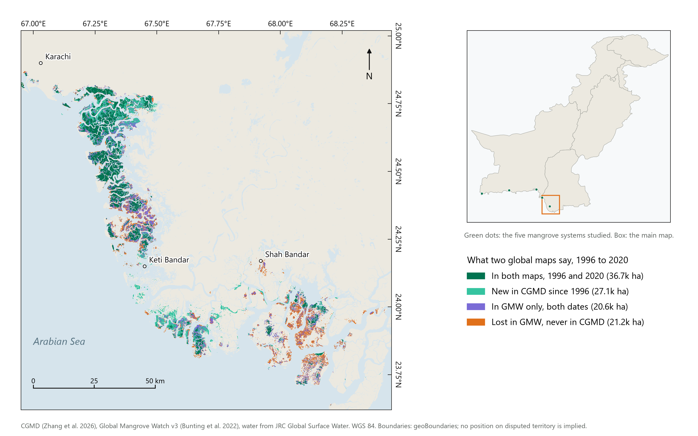
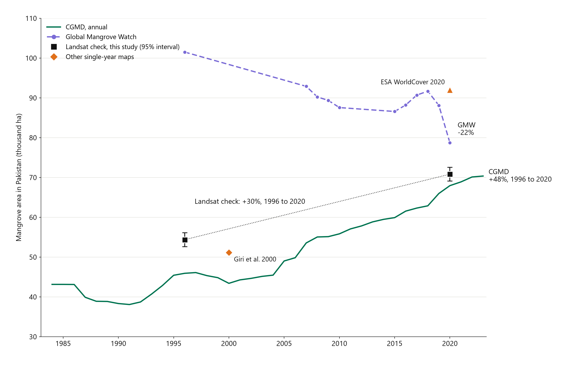

# Did Pakistan's mangroves grow or shrink? Testing two global maps that disagree

Two leading global mangrove products give opposite answers for Pakistan between 1996 and 2020. CGMD reports a gain of 48% (45,932 to 67,960 ha). Global Mangrove Watch v3 reports a loss of 22% (101,522 to 78,711 ha). This study tests the pixels they dispute against the Landsat archive.

**Result:** a net gain of about 30%, or 16,459 ha (95% sampling interval 14,021 to 19,066), across all five mangrove systems on Pakistan's coast. Three alternative readings of the test all keep the gain, at +16% to +31%.





## Design

1. **Whole coast.** Jiwani, Kalmat Khor and Miani Hor (Balochistan), Karachi coast and the Indus Delta (Sindh). CGMD's `MiddleEast` tile ends at 67°E, and 92% of Pakistan's mangrove lies east of that line, so the `MiddleEast` and `SouthAsia` tiles are mosaicked.
2. **Area, not average canopy.** Mean canopy percentage hardly moved (72.1% to 75.3%, Hamed-Rao p = 0.11 for 1984 to 2023), while canopy-equivalent area rose from 31,126 to 52,997 ha (p < 0.001).
3. **Trends with autocorrelation handled.** Theil-Sen slopes with the Hamed-Rao modified Mann-Kendall test.
4. **A test on the disputed pixels.** Stratified random points in each site and each combination of the two maps' 1996 and 2020 classes (9,032 mapped points). Dry-season 90th percentile Landsat NDVI for 1994 to 1998 and 2018 to 2022. The high percentile favours low-tide views. Each epoch gets its own threshold, set on pixels where both products agree (AUC 0.997), so no cross-sensor harmonisation is needed.
5. **Other maps.** Giri et al. (2000 baseline) and ESA WorldCover 2020, which uses Sentinel-1 and 2 rather than Landsat.
6. **Carbon.** IPCC Wetlands Supplement Tier 1, tropical dry mangrove: 92 t d.m./ha above ground, root ratio 0.29, carbon fraction 45.1%, giving 53.5 t C/ha in biomass.

## Limits

- No field data and no high-resolution interpretation. The intervals cover sampling error only.
- NDVI separates vegetation from non-vegetation. It cannot tell mangrove from other plants, and it shares Landsat with CGMD, so it is not fully independent of CGMD.
- Absolute area remains uncertain. For 2020 the estimates run from 67,960 ha (CGMD) to 91,990 ha (WorldCover). WorldCover calls 72% of the GMW-only class mangrove, while NDVI finds 16% to 22% of it vegetated, so sparse dwarf stands may be undercounted here.
- The carbon figure (0.88 Mt C, 0.80 to 0.98 across the IPCC default ranges) assumes new stands reach the default stock. Young plantations hold less, and soil carbon is excluded.
- Tide height is handled only through the percentile composite.
- No flood pulse was detectable in the delta's canopy in the years after the 2010 and 2022 Indus floods (permutation p = 0.59, two events).

## Running

Earth Engine scripts (`scripts/00` to `03`, `05`) need a service account set up as in `src/common.py`. Analysis and figures:

```
uv run --no-project --with pandas --with numpy --with scipy --with pymannkendall python scripts/04_analysis.py
uv run --no-project --with matplotlib --with rasterio --with numpy --with pandas --with shapely python scripts/06_figures.py
```

All reported statistics are in `outputs/results.json`.

## Credit and sources

The starting point was Amirhossein Ahrari's public Earth Engine tutorial on mangrove change detection (notebook 0245 in [AmirhosseinAhrari/GoogleEarthEngine](https://github.com/AmirhosseinAhrari/GoogleEarthEngine)). The code here is written afresh.

- Zhang, Z., Murray, N., Song, X., et al. (2026). Continuous Global Mangrove Dynamics: annual mangrove fractional canopy cover, 1984 to 2023. https://doi.org/10.5281/zenodo.18496588
- Bunting, P., et al. (2022). Global Mangrove Extent Change 1996 to 2020: Global Mangrove Watch Version 3.0. Remote Sensing 14, 3657. https://doi.org/10.3390/rs14153657
- Giri, C., et al. (2011). Status and distribution of mangrove forests of the world using earth observation satellite data. Global Ecology and Biogeography 20, 154 to 159.
- Zanaga, D., et al. (2021). ESA WorldCover 10 m 2020 v100. https://doi.org/10.5281/zenodo.5571936
- Pekel, J.-F., et al. (2016). High-resolution mapping of global surface water and its long-term changes. Nature 540, 418 to 422.
- Hamed, K. H., and Rao, A. R. (1998). A modified Mann-Kendall trend test for autocorrelated data. Journal of Hydrology 204, 182 to 196.
- IPCC (2014). 2013 Supplement to the 2006 IPCC Guidelines for National Greenhouse Gas Inventories: Wetlands, Chapter 4.

## Licence

Code under the MIT licence. The input datasets keep their own licences (CGMD and GMW v3 are CC BY 4.0).
